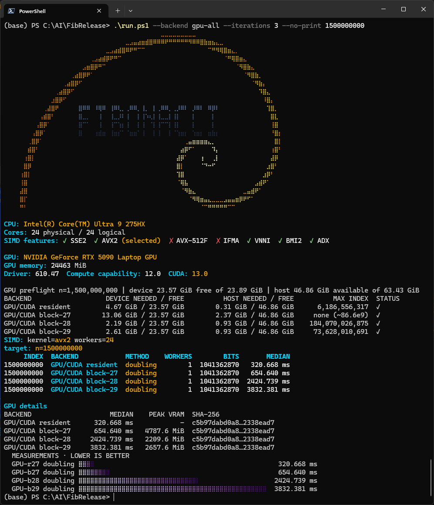

# Exact Fibonacci at scale: CPU SIMD and CUDA

> **Fibonacci: fast and huge.**

## Results at a glance

| case | index `n` | size of `F(n)` | time | hardware | verification |
|---|---:|---:|---:|---|---|
| Largest exact result | **100,000,000,000** | 69.42 Gbit / 8.68 GB | 249.35 s call, 257.88 s total | RTX 5090 Laptop 24 GB | **GPU == GMP** |
| Largest measured result | **184,000,000,000** | 127.74 Gbit / 15.97 GB | 474.39 s call, 489.67 s total | RTX 5090 Laptop 24 GB | hash only, measured max |
| Largest exact on 16 GB | **61,865,563,170** | 42.95 Gbit / 5.37 GB | 138.25 s call, 142.50 s total | RTX 3080 Laptop 16 GB | **GPU == GMP** |
| Resident-engine limit | 6,186,556,317 | 4.29 Gbit / 536.9 MB | 1.94 s call | RTX 5090 Laptop 24 GB | GMP exact |

<p align="center">
  
</p>

*fib-simd-lab running all four CUDA engines at `n = 1,500,000,000` with three
iterations each.*

At the small end, `F(1,000,000)` takes **0.90 ms** and `F(1,000,000,000)`
takes **258.36 ms** on the reference RTX 5090 Laptop. The 16 GB RTX 3080
Laptop needs **1.10 ms** and **359.18 ms** for the same indices.

Every result is an exact integer computed with `F(0) = 0` and `F(1) = 1`; no
floating-point value is ever used to produce a Fibonacci number. Times are
medians from the current one-process-per-method protocol; laptop clocks and
thermal state vary.

## Overview

An exact Fibonacci benchmark suite with independent CPU and GPU engines. The
suite is built around `fib-simd-lab`, a Rust CLI that runs:

- a project-local 32-bit limb integer with runtime **SSE2 / AVX2 / AVX-512F**
  dispatch and fast doubling;
- the `fib-rust` **num-bigint** and **GMP** backends;
- four optional CUDA engines: a resident 2^27 transform, and blockwise 2^27,
  2^28, and 2^29 engines.

Large results are verified by full byte comparison or SHA-256, never by bit
length alone.

## Backends

| `--backend` | Engine | Maximum index | Notes |
|---|---|---:|---|
| `cpu` | CPU/SIMD | memory-bound | project-local limbs, AVX2/AVX-512 dispatch |
| `num-bigint` | CPU/num-bigint | memory-bound | pure Rust `num-bigint` |
| `gmp` | CPU/GMP | memory-bound | GMP through `rug`, integer support only |
| `gpu` | GPU/CUDA resident | **6,186,556,317** | 2^27 transform, 3x32-bit, process-backed |
| `gpu-block27` | GPU/CUDA block-27 | **61,865,563,170** exact; 86.6e9 measured | no planner cap; VRAM-bound; 86.6e9 is hash-only |
| `gpu-block28` | GPU/CUDA block-28 | **184,070,026,875** planner | verified 100e9, measured 184e9 |
| `gpu-block29` | GPU/CUDA block-29 | **73,628,010,691** | 2^29, 2x48-bit, 3+3 blocks |
| `gpu-block` | all three block engines | per engine | one table row each |
| `gpu-all` | all four GPU engines | per engine | resident + block27/28/29 |
| `auto` | fastest fitting CUDA engine | up to 184,070,026,875 | index + memory preflight |

`auto` order: resident, block27, block28, block29. The CLI checks free VRAM and
available host RAM before starting an engine, prints a
`GPU preflight` table, and skips engines that cannot run the requested index.
`--force-memory` and `--force-index` override the checks explicitly.

## Repository layout

```text
build.ps1                one-command Windows build (CUDA + Rust + hashes)
run.ps1                  launch dist/fib-simd-lab.exe from the repo root
rust/                    fib-rust library (num-bigint/GMP) and simd-lab CLI
  simd-lab/src/          CLI, CPU SIMD kernels, CUDA adapters, progress, report
cuda-ntt/                the four production CUDA engines
  common/               shared limb I/O, timing, stats JSON
  resident-27/          2^27 resident engine
  block-27/              2^27 blockwise engine
  block-28/              2^28 2x48 option-A engine
  block-29/       2^29 2x48 engine
docs/                    limits, benchmarks, hashes, verification, build
dist/                    build output (ignored by git)
```

## Build

Prerequisites for the full suite:

- Windows 10/11 x64;
- Rust GNU toolchain `1.99.1-x86_64-pc-windows-gnu`;
- MSYS2/MinGW `gcc`, `make`, `m4` (needed by `gmp-mpfr-sys`);
- CUDA 13.0 with `nvcc`, and Visual Studio Build Tools with the C++ workload;
- NVIDIA GPU matching the CUDA architecture (default `sm_120`; pass
  `-CudaArch` for another target).

From the repository root:

```powershell
.\build.ps1
```

Other modes:

```powershell
.\build.ps1 -SkipCuda     # CPU/SIMD, num-bigint, GMP only
.\build.ps1 -SkipRust     # CUDA engines only
.\build.ps1 -Check        # fmt, clippy, tests, and C++/CUDA lint before the build
```

Build outputs:

```text
dist\fib-simd-lab.exe
cuda-ntt\resident-27\build\resident27_fib.exe
cuda-ntt\block-27\build\block27_fib.exe
cuda-ntt\block-28\build\block28_fib.exe
cuda-ntt\block-29\build\block29_fib.exe
dist\SHA256SUMS.txt
```

The CLI discovers those relative CUDA paths automatically. Override them with
`--gpu-resident-bin`,
`--gpu-block27-bin`, `--gpu-block28-bin`, or `--gpu-block29-bin`. See
`docs/BUILD_WINDOWS.md` for manual commands.

### CUDA engine protocol

All four engines are process-backed and share one protocol:

```text
<engine>.exe fib --n N --out FILE --iterations R --stats-json STATS.json
<engine>.exe fib ... --progress-file PROGRESS.txt
```

One process runs all `R` iterations after a single CUDA initialization. It
writes the final limb file and one JSON statistics object:

```json
{"engine":"block-28","n":1000000000,"iterations":3,
 "samples_ms":[...],"stream_ms":[...],"call_ms":[...],"total_ms":[...],
 "peak_vram_mib":2209.6,"host_peak_mib":1060.0}
```

The Rust CLI computes the median from `samples_ms`, hashes the output file, and
compares it with the selected reference. It never starts one process per
iteration. When `--progress-file` is present, the engine writes
`iteration total [detail]` after every sample, and the CLI shows a second live
row with the per-iteration bar and the latest sample/VRAM value.

## Run

```powershell
.\run.ps1 --show-limits

.\run.ps1 --backend cpu --method doubling --iterations 3 --no-print 1000000000

.\run.ps1 --backend gpu --method doubling --iterations 3 --no-print 1000000000

.\run.ps1 --backend gpu-all --method doubling --iterations 1 --no-print 1000000000

.\run.ps1 --backend auto --method doubling --no-print 100000000000
```

Useful flags:

| Flag | Meaning |
|---|---|
| `--backend VALUE` | backend selection, see the table above |
| `--method direct\|matrix\|doubling\|compare` | CPU methods; CUDA runs `doubling`/`compare` |
| `--iterations N` | timed samples per method |
| `--no-print` | omit the decimal value, keep the table and chart |
| `--gpu-sha256 HEX` | compare a GPU result against a known SHA-256 |
| `--gpu-reference PATH` | compare against a canonical `.bin` limb file |
| `--gpu-out PATH` | keep the full GPU result |
| `--show-limits` | verified/planner limits and memory models for this machine |
| `--force-simd` | do not skip slow CPU SIMD methods at large indices |
| `--no-progress`, `--no-banner`, `--no-chart`, `--json` | UI/output control |

The default backend is `cpu`, the project-local SIMD implementation. Above
`n = 64,000,000` the CLI skips CPU/SIMD as too slow. If `--backend` was not
given, it automatically switches to `auto`, which chooses the fastest fitting
CUDA engine. An explicit `--backend cpu` still exits with an error; use
`--force-simd` to force the CPU path.

The result table is printed before the chart and includes index, backend,
method, workers, bit length, and median time.

## Limits on the reference machine

Reference configuration: Intel Core Ultra 9 275HX (24 cores), 63.4 GB RAM,
NVIDIA RTX 5090 Laptop (23.89 GiB), driver 610.47, CUDA 13.0, `sm_120`.

| Backend | Verified exact | Measured max | Planner/hard max | Peak VRAM | Limiter |
|---|---:|---:|---:|---:|---|
| resident 2^27 | 6,186,556,317 | 6,186,556,317 | 6,186,556,317 | 14.80 GiB | 2^27 transform |
| block-27 2^27 | 61,865,563,170 | 86,600,000,000 | none | 22.81 GiB | device VRAM |
| block-28 2^28 | 100,000,000,000 | 184,000,000,000 | 184,070,026,875 | 22.81 GiB | k=15 boundary |
| block-29 2^29 | 61,865,563,170 | 73,628,010,691 | 73,628,010,691 | 22.81 GiB | 3+3 block planner |

`185e9` needs `k=16` for block-28 and is rejected by the engine preflight;
`200e9` cannot fit a 24 GB card. The full memory models and per-index table are
in `docs/LIMITS.md`.

## Benchmarks

Times are seconds on the reference machine. **stream/device** is CUDA-event
time, **call** includes host CRT/carry, **total** includes process output and
hashing where noted. These figures were recorded with the earlier transport
(earlier in-process resident transport, one process per block iteration); the current engine protocol
runs all iterations inside one process, so medians exclude process startup.

| Engine | n | stream | call | total | peak VRAM |
|---|---:|---:|---:|---:|---:|
| resident | 6,186,556,317 | 1.712 | 7.319 | — | 14.80 GiB |
| block-27 | 61,865,563,170 | 66.06 | 97.51 | 134.41 | 19.81 GiB |
| block-27 | 86,600,000,000 | 121.28 | 156.76 | 205.56 | 22.81 GiB |
| block-28 | 61,865,563,170 | 66.17 | 138.13 | 144.78 | 13.28 GiB |
| block-28 | **100,000,000,000** | **169.07** | **272.27** | **281.46** | **16.28 GiB** |
| block-28 | 184,000,000,000 | 335.92 | 496.77 | 515.03 | 22.28 GiB |
| block-29 | 61,865,563,170 | 82.44 | 243.46 | 251.27 | 22.28 GiB |
| block-29 | 73,628,010,691 | 82.18 | 268.37 | 276.79 | 22.28 GiB |

At 61.865e9, block-27 is 1.25x faster than block-29 in stream time, 2.50x
faster in call time, and needs 2.5 GiB less VRAM. Full tables, host peaks, and
limit probes are in `docs/BENCHMARKS.md`.

A portable 16 GB profile was also measured on an **RTX 3080 Laptop with a
Ryzen 9 5900HX**. CPU/SIMD, num-bigint, and GMP results through `1e8`, all four
GPU engines through `1e9`, the block engines at `6.186e9`, and block-28 at
`61.865e9` are in `docs/BENCHMARKS.md` under "Portable target".

## Verified results

Canonical binary format: `u64 limb_count` followed by `limb_count` little-endian
`u32` limbs. A result is exact only when the full bytes match an independent
computation.

| n | bits | bytes | SHA-256 | status |
|---:|---:|---:|---|---|
| 6,186,556,317 | 4,294,966,696 | 536,870,848 | `E2AC2BC743649BC0D295C29A08941DBBB00AB97B3205B3DDF2315B5D81A87750` | GMP |
| 61,865,563,170 | 42,949,666,962 | 5,368,708,380 | `4F5D93B4BBD63C16C6FB68BA13DDEEECCE65714526E580F30AC8A2ADE605E580` | GMP |
| **100,000,000,000** | **69,424,191,362** | **8,678,023,932** | `9117AD9310DA4A1CC4EB760F0C3655760771B270E080F2EFA7170F670EA49CA0` | **GPU == GMP** |
| 184,000,000,000 | 127,740,512,128 | 15,967,564,024 | `CDD416B4E41B1BC4D188DCC5B94296473963CE7822E39B2268BE8A74DA4EC758` | hash, measured max |

The `1e11` SHA-256 is reproduced by both the block-28 GPU engine and the
anchored GMP/limb-array reference. The `1e11` and `184e9` GPU hashes were
re-verified on the current build on 2026-11-08; that check was GPU-only, so the
exactness labels in the table are unchanged. The portable RTX 3080 Laptop run
reproduced every shared hash through `61.865e9`. The complete hash list,
including block-27 and block-29 limit points, is in `docs/HASHES.md` and
`docs/LARGE_RESULTS.md`.

## Verification

```powershell
# Compare a GPU run against the canonical 1e11 hash
.\run.ps1 --backend gpu-block28 --method doubling --no-print `
  --gpu-sha256 9117AD9310DA4A1CC4EB760F0C3655760771B270E080F2EFA7170F670EA49CA0 `
  100000000000

# Compare against a full limb file
.\run.ps1 --backend gpu-block28 --method doubling --no-print `
  --gpu-reference path\to\gmp-block28-F-100000000000.bin `
  100000000000
```

See `docs/VERIFICATION.md` for the file format, the anchored GMP chain, and the
exactness status of every published point.

## Checks

```powershell
.\scripts\lint.ps1          # rustfmt, clippy, tests, g++/MSVC/nvcc analysis
.\scripts\host-tests.ps1    # CPU reference tests; no GPU required
.\scripts\engine-smoke.ps1  # all four engines at 1e6 against a fixed hash
.\scripts\bench-16gb.ps1    # CPU/SIMD/GPU benchmark profile for a 16 GB card
.\scripts\package-bench-16gb.ps1  # build dist\fib-bench-16gb.zip
```

`lint.ps1` accepts `-SkipRust`, `-SkipCpp`, and `-SkipCuda` for partial runs.
The hosted CI runs Rust checks in `rust.yml` and the host C++ checks/tests in
`cpp.yml`; the GPU smoke test is run on a self-hosted CUDA machine.

## Development notes

- CUDA engines are independent programs; the CLI compares their canonical
  little-endian limb output byte-for-byte.
- The CPU SIMD integer is project-local and selected at runtime; all kernels
  are checked against a scalar implementation.
- `--show-limits --json` exposes the current limits and resource estimates for
  tooling.
- Only the production Rust/CUDA tree, documentation, and canonical hashes are
  included; development probes and unrelated prototypes are not part of it.

## License

The project is released under the **MIT License** (see [`LICENSE`](LICENSE)),
copyright (c) 2026 Alexander Gmar.

Third-party components keep their own licenses; see
[`THIRD_PARTY_NOTICES.md`](THIRD_PARTY_NOTICES.md). In particular:

- `rug` / `gmp-mpfr-sys` and the bundled GMP, MPFR, and MPC are
  **LGPL-3.0-or-later**. The default build links them statically, so a
  distributed `fib-simd-lab.exe` is a combined work with LGPL components and
  must satisfy LGPL section 4 (source/relinking information or replaceable
  shared libraries).
- Compiled CUDA engines may contain NVIDIA runtime components and are
  governed by the NVIDIA CUDA Toolkit EULA; the MIT license does not relicense
  them.

Publishing only this source tree and `build.ps1` avoids redistributing NVIDIA
or GMP binaries. If you publish prebuilt Windows binaries, include the LGPL
license texts and the notices for the ISC/Unicode components listed in
`THIRD_PARTY_NOTICES.md`.

---

**Author**: Alexander Gmar.
